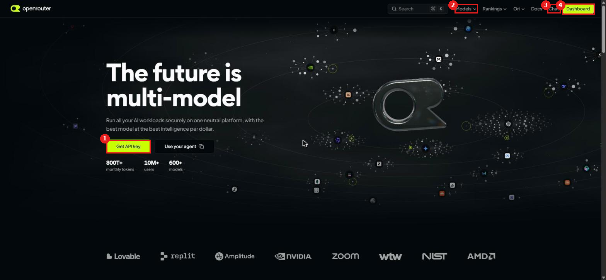

# 01. Découvrir OpenRouter

> **Point de départ** : un navigateur. **Résultat** : savoir ce qu'est OpenRouter et ce qu'il coûte.

OpenRouter est un service en ligne qui donne accès, avec un seul compte et une seule clé, à plusieurs centaines de modèles d'IA hébergés par d'autres fournisseurs (Google, NVIDIA, Anthropic, OpenAI, Mistral…). Les programmes l'appellent au format de l'API d'OpenAI : tout outil qui accepte « une adresse, une clé, un nom de modèle » fonctionne avec lui.

| | OpenRouter |
|---|---|
| Ce que c'est | un service en ligne, rien à installer |
| Paiement | crédits achetés à l'avance, sans abonnement ; chaque appel à un modèle payant est déduit du solde |
| Modèles gratuits | 17 le 18 novembre 2026, suffixe `:free` ; 50 requêtes par jour sans achat, 1 000 par jour après 10 $ de crédits achetés, 20 par minute |
| Frais | 5,5 % à l'achat de crédits par carte, 0,80 $ au minimum ; taxe du pays de facturation en plus |
| Données | les questions partent chez le fournisseur du modèle choisi (chapitre 05) |

**Étape 1. Ouvrir le site.**

*Où* : navigateur, adresse `https://openrouter.ai`.

*Écran* : page d'accueil, compte connecté.

| N° | Élément | Rôle |
|---|---|---|
| 1 | « Get API key » | création d'une clé (chapitre 03) |
| 2 | « Models » | catalogue des modèles (chapitre 04) |
| 3 | « Chat » | essai des modèles dans le navigateur (chapitre 06) |
| 4 | « Dashboard » | tableau de bord : crédits, clés, journaux |

*Résultat* : le site est ouvert. Sans compte, le catalogue et les prix se consultent librement ; le compte se crée par « Sign up » (Google, GitHub ou adresse e-mail).
