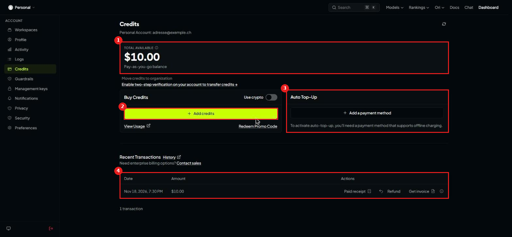
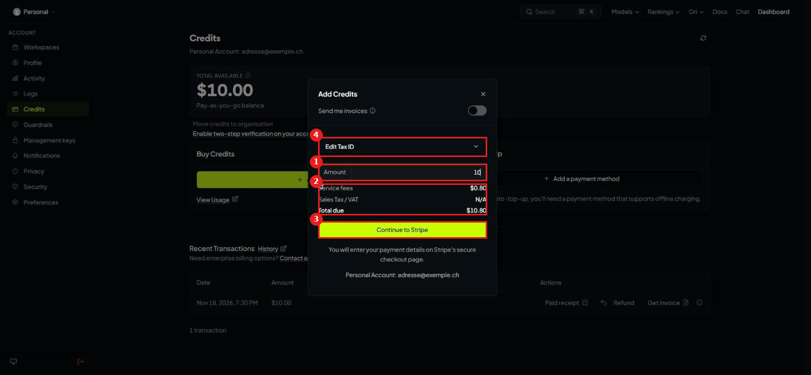

# 02. Créer le compte et ajouter des crédits

> **Point de départ** : chapitre 01. **Résultat** : un compte avec un solde de crédits.

**Étape 1. Créer le compte.**

*Où* : `https://openrouter.ai`, bouton « Sign up ». L'inscription se fait avec un compte Google, GitHub ou une adresse e-mail, puis une validation par e-mail. Un compte neuf reçoit automatiquement une clé « Default key » (chapitre 03).

**Étape 2. Ouvrir la page des crédits.**

*Où* : « Dashboard », menu de gauche « Credits ».

*Écran* : solde et achats.

| N° | Élément | Rôle |
|---|---|---|
| 1 | « Total available » | solde disponible |
| 2 | « Add credits » | achat de crédits |
| 3 | « Auto Top-Up » | recharge automatique quand le solde baisse ; demande une carte enregistrée ; laissée désactivée ici |
| 4 | « Recent Transactions » | achats passés, reçu, facture, remboursement (« Refund ») |

**Étape 3. Choisir le montant.**

*Où* : « Add credits ».

*Écran* : fenêtre d'achat, adresse du compte masquée.

| N° | Élément | Rôle |
|---|---|---|
| 1 | « Amount » | montant en dollars |
| 2 | « Service fees », « Sales Tax / VAT », « Total due » | frais (0,80 $ pour 10 $), taxe, total |
| 3 | « Continue to Stripe » | passage à la page de paiement |
| 4 | « Edit Tax ID » | numéro de TVA d'entreprise ; vide pour un particulier |

La taxe peut s'afficher « N/A » ou « — » : elle est calculée à l'étape suivante, d'après le pays de facturation.

**Étape 4. Payer sur la page Stripe.**

*Où* : page `checkout.stripe.com` ouverte par « Continue to Stripe ». La carte se saisit sur cette page, jamais sur OpenRouter.

1. Choisir le **pays de résidence** dans l'adresse de facturation : il fixe la taxe (8,1 % pour la Suisse, 20 % pour la France).
2. Saisir le **nom exactement comme sur la carte** : un nom différent fait refuser le paiement par la banque, avec le seul message « Votre carte a été refusée. ».
3. Vérifier le total, taxe comprise, puis payer. La banque peut demander une validation dans son application.

*Résultat* : le solde passe à 10,00 $ et l'achat apparaît dans « Recent Transactions » (capture de l'étape 2). Avec au moins 10 $ achetés depuis la création du compte, la limite des modèles gratuits passe de 50 à 1 000 requêtes par jour : la clé n'est plus au palier gratuit (`is_free_tier False`, chapitre 08).

D'après plusieurs sources de 2026, les crédits non utilisés expirent un an après l'achat et le remboursement (« Refund ») n'est possible que dans les 24 heures ; les conditions d'utilisation d'OpenRouter font foi.
