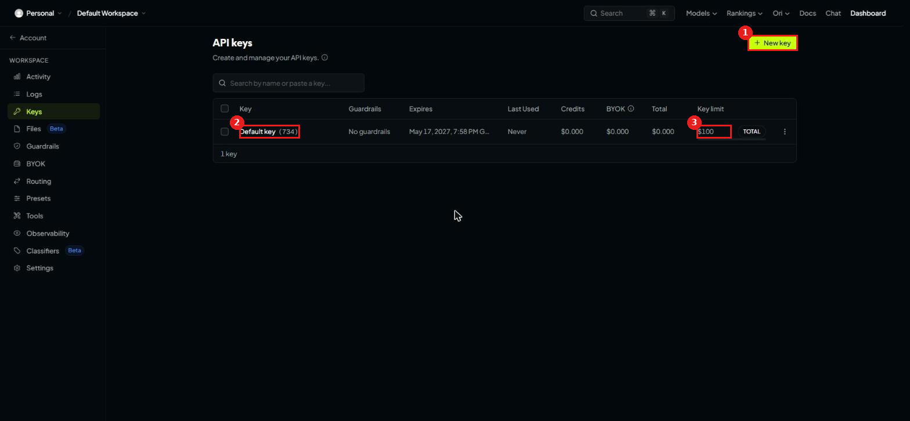
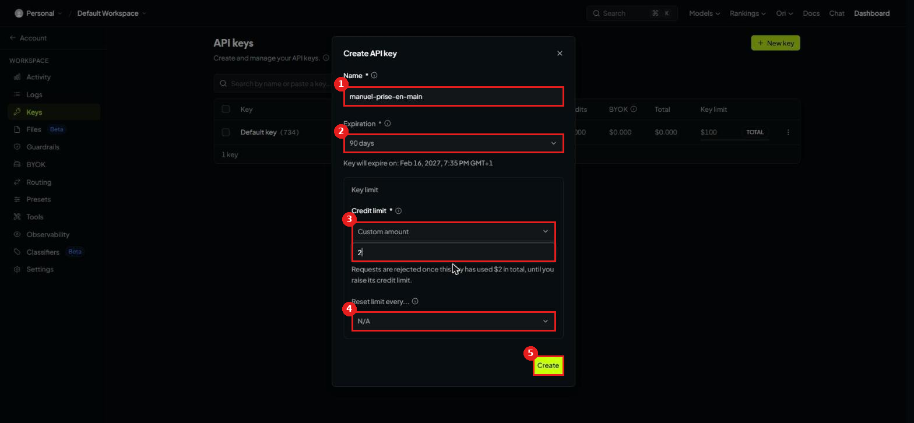
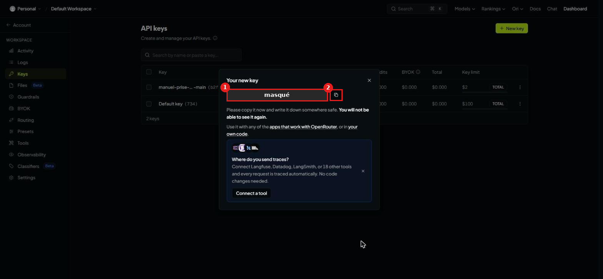
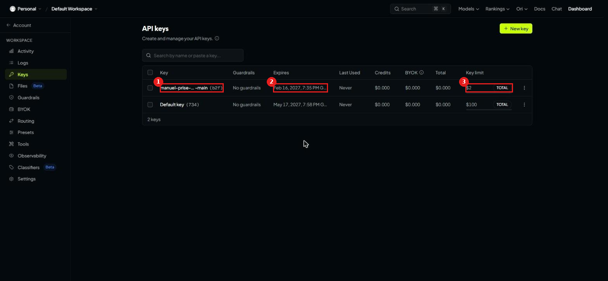

# 03. Créer une clé API plafonnée

> **Point de départ** : chapitre 02. **Résultat** : une clé limitée à 2 $, rangée dans le fichier `.env`.

Une clé donne accès au solde du compte. Une clé par usage (un outil, un projet), chacune avec un plafond, limite les dégâts si elle fuit.

**Étape 1. Ouvrir la liste des clés.**

*Où* : « Dashboard », menu « Keys » (espace « Default Workspace »).



*Écran* : clés du compte.

| N° | Élément | Rôle |
|---|---|---|
| 1 | « New key » | création d'une clé |
| 2 | « Default key » | clé créée automatiquement à l'inscription |
| 3 | « Key limit » | plafond de dépense de la clé |

Le plafond de 100 $ de la « Default key » n'est pas un montant payé : c'est la dépense maximale autorisée pour cette clé, dans la limite du solde réel (10 $ ici). Il se baisse par le menu « ⋮ » de la ligne, ou la clé se supprime si elle ne sert pas.

**Étape 2. Remplir le formulaire.**

*Où* : « New key ».



*Écran* : formulaire rempli.

| N° | Élément | Rôle |
|---|---|---|
| 1 | « Name » | nom de la clé, ici `manuel-prise-en-main` |
| 2 | « Expiration » | durée de validité, ici « 90 days » |
| 3 | « Credit limit » | plafond : « Custom amount », 2 (dollars) ; au-delà, les requêtes sont refusées |
| 4 | « Reset limit every… » | remise à zéro périodique du plafond (jour, semaine, mois) ; « N/A » : plafond total |
| 5 | « Create » | création |

**Étape 3. Copier la clé.**



*Écran* : la clé n'est affichée qu'une fois (masquée sur la capture).

| N° | Élément | Rôle |
|---|---|---|
| 1 | clé | `sk-or-v1-…`, visible une seule fois |
| 2 | bouton de copie | copie dans le presse-papiers |

Coller la clé dans le fichier `.env` du dossier, à partir du modèle :

```bash
cp .env.example .env
nano .env        # OPENROUTER_API_KEY=sk-or-v1-...   Ctrl+O enregistre, Ctrl+X quitte
```

Le fichier `.env` est exclu de git (`.gitignore`). La clé ne s'écrit jamais dans un fichier suivi, une capture ou un message.

*Résultat* :



| N° | Élément | Rôle |
|---|---|---|
| 1 | `manuel-prise-…-main` | nouvelle clé |
| 2 | « Expires » | fin de validité : 16 février 2027 |
| 3 | « Key limit » | 2 $ |
