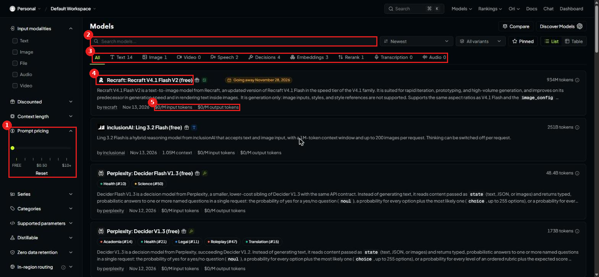
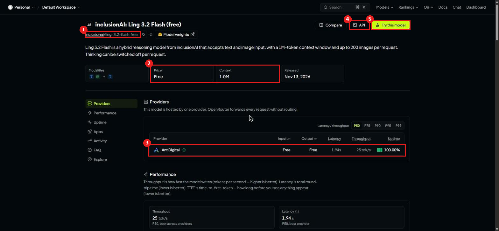

# 04. Choisir un modèle, gratuit de préférence

> **Point de départ** : chapitre 01. **Résultat** : l'identifiant d'un modèle gratuit, prêt à être appelé.

**Étape 1. Filtrer les modèles gratuits.**

*Où* : menu « Models », puis le curseur « Prompt pricing » placé sur « FREE » (adresse directe : `https://openrouter.ai/models?max_price=0`).



*Écran* : catalogue limité aux modèles gratuits.

| N° | Élément | Rôle |
|---|---|---|
| 1 | « Prompt pricing » | filtre par prix ; « FREE » ne garde que les modèles à 0 $ |
| 2 | « Search models… » | recherche par nom |
| 3 | onglets « Text », « Image », « Embeddings », « Rerank »… | type de modèle et nombre de modèles gratuits de ce type |
| 4 | nom du modèle | ouvre sa fiche |
| 5 | « $0/M input tokens », « $0/M output tokens » | prix par million de jetons, en entrée et en sortie |

Un bandeau « Going away » annonce la fin de la gratuité ou du modèle : la liste change chaque semaine.

**Étape 2. Lire la fiche d'un modèle.**

*Où* : clic sur « inclusionAI: Ling 3.2 Flash (free) ».



*Écran* : fiche du modèle.

| N° | Élément | Rôle |
|---|---|---|
| 1 | `inclusionai/ling-3.2-flash:free` | identifiant à utiliser dans les appels ; le bouton voisin le copie |
| 2 | « Price », « Context » | prix (« Free ») et taille de contexte (1 million de jetons) |
| 3 | « Providers » | fournisseur qui fait tourner le modèle, prix, latence, débit, disponibilité |
| 4 | « API » | exemples d'appel prêts à copier |
| 5 | « Try this model » | essai dans le chat (chapitre 06) |

**Étape 3. Obtenir la liste à jour, sans le navigateur.**

```bash
exemples/01_modeles_gratuits.sh
```

*Sortie* (18 novembre 2026, extrait de `exemples/sorties/sorties-verifiees.txt`) :

```text
baidu/ernie-5.5-flash-preview:free                      contexte   1024000
cohere/north-mini-code:free                             contexte    256000
google/gemma-4-26b-a4b-it:free                          contexte    262144
google/gemma-4-31b-it:free                              contexte    262144
inclusionai/ling-3.2-flash:free                         contexte   1048576
nvidia/nemotron-3-ultra-550b-a55b:free                  contexte   1000000
nvidia/nemotron-3.5-lightning:free                      contexte   1000000
nvidia/nemotron-3.5-super-vl:free                       contexte   1000000
openrouter/free                                         contexte    200000
17 modèles gratuits sur 478
```

`openrouter/free` n'est pas un modèle : il laisse OpenRouter choisir un modèle gratuit disponible.

| Besoin | Modèle gratuit à essayer |
|---|---|
| Conversation, résumé | `inclusionai/ling-3.2-flash:free`, `google/gemma-4-31b-it:free` |
| Raisonnement difficile | `nvidia/nemotron-3-ultra-550b-a55b:free` |
| Code | `cohere/north-mini-code:free` |
| Images en entrée | `nvidia/nemotron-3.5-super-vl:free` |
