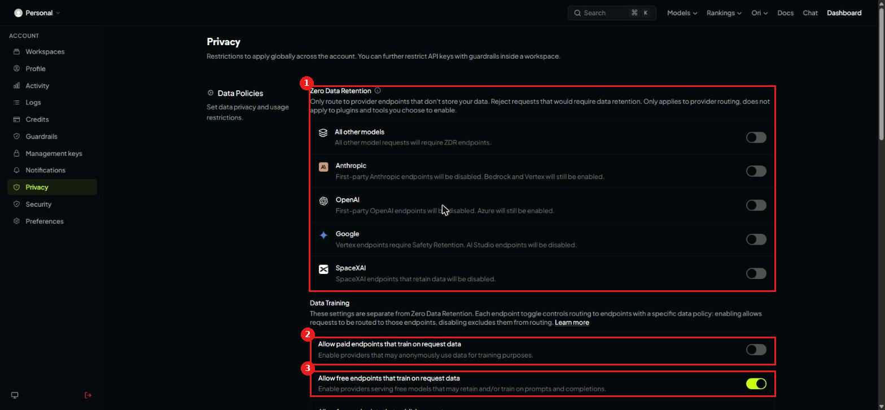

# 05. Régler la confidentialité

> **Point de départ** : chapitre 02. **Résultat** : savoir où partent les questions et le régler.

Chaque question est envoyée au fournisseur qui fait tourner le modèle. Beaucoup de fournisseurs de modèles gratuits gardent les questions, s'en servent pour entraîner leurs modèles, ou les publient. Aucun document confidentiel ne passe par un modèle gratuit.

**Étape 1. Ouvrir les réglages de confidentialité.**

*Où* : « Dashboard », menu de compte « Privacy ».

*Écran* : réglages par défaut d'un compte neuf.

| N° | Élément | Rôle |
|---|---|---|
| 1 | « Zero Data Retention » | n'utiliser que des fournisseurs qui ne gardent rien, pour tous les modèles ou par éditeur |
| 2 | « Allow paid endpoints that train on request data » | modèles payants dont le fournisseur entraîne sur les questions : désactivé par défaut |
| 3 | « Allow free endpoints that train on request data » | modèles gratuits dont le fournisseur garde ou entraîne sur les questions : **activé par défaut** |

Plus bas sur la même page :

| Réglage | Rôle |
|---|---|
| « Allow free endpoints that publish prompts » | modèles gratuits dont le fournisseur publie questions et réponses dans des jeux de données publics |
| « Maximum API key lifetime » | durée maximale des clés du compte |
| « Allowed Providers », « Ignored Providers » | liste des fournisseurs autorisés ou exclus |
| « Eligibility Preview » | nombre de modèles encore utilisables avec ces réglages |

Désactiver le réglage 3 protège les questions, mais retire la plupart des modèles gratuits : le compteur « Eligibility Preview » le montre. Le compte de ce manuel garde le réglage par défaut et n'envoie aux modèles gratuits que des questions sans donnée personnelle.
