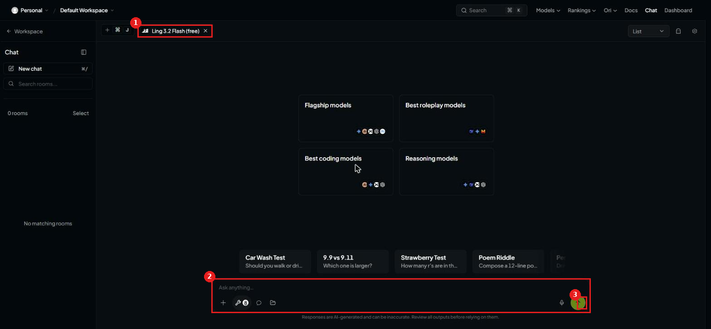
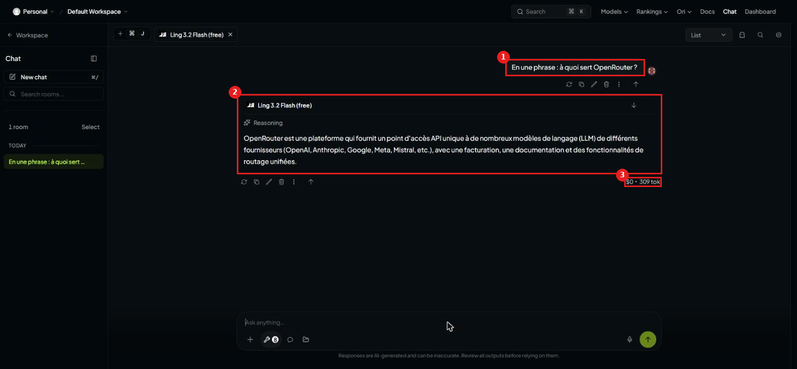

# 06. Essayer un modèle dans le chat

> **Point de départ** : chapitres 02 et 04. **Résultat** : une première réponse, sans écrire de code.

**Étape 1. Ouvrir le chat avec un modèle.**

*Où* : fiche du modèle, « Try this model », ou menu « Chat ».

*Écran* : chat ouvert sur un modèle gratuit.

| N° | Élément | Rôle |
|---|---|---|
| 1 | « Ling 3.2 Flash (free) » | modèle utilisé ; le « + » voisin en ajoute d'autres pour comparer leurs réponses côte à côte |
| 2 | « Ask anything… » | zone de saisie |
| 3 | flèche | envoi |

**Étape 2. Poser une question.**

*Où* : zone de saisie, texte `En une phrase : à quoi sert OpenRouter ?`, touche Entrée.

*Écran* : réponse du modèle.

| N° | Élément | Rôle |
|---|---|---|
| 1 | question | message envoyé |
| 2 | réponse | texte du modèle ; « Reasoning » déplie son raisonnement |
| 3 | « $0 • 309 tok » | coût et nombre de jetons de l'échange |

*Résultat* : réponse en quelques secondes, coût 0 $. La conversation s'ajoute à la liste « Chat », à gauche.
