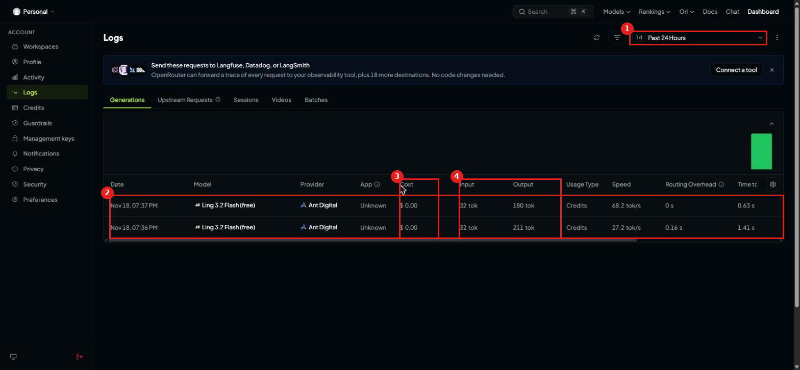

# 08. Suivre sa consommation

> **Point de départ** : chapitres 06 ou 07. **Résultat** : savoir ce qui a été dépensé, par qui et sur quel modèle.

**Étape 1. Lire les journaux.**

*Où* : « Dashboard », menu « Logs ».



*Écran* : appels des 24 dernières heures (les deux appels du chapitre 07).

| N° | Élément | Rôle |
|---|---|---|
| 1 | « Past 24 Hours » | période affichée |
| 2 | lignes | un appel par ligne : date, modèle, fournisseur |
| 3 | « Cost » | coût de l'appel : 0,00 $ pour un modèle gratuit |
| 4 | « Input », « Output » | jetons envoyés et reçus |

Le menu « Activity » donne les mêmes chiffres en graphiques, par jour, par modèle et par clé.

**Étape 2. Lire l'état de la clé par l'API.**

```bash
exemples/04_consommation.sh
```

*Sortie* (18 novembre 2026) :

```text
limit            2
limit_remaining  2
usage            0
usage_daily      0
is_free_tier     False
expires_at       2027-02-16T18:35:04.989Z
crédits achetés 10 | dépensés 0
```

| Champ | Sens |
|---|---|
| `limit`, `limit_remaining` | plafond de la clé et reste |
| `usage`, `usage_daily` | dépense totale et du jour, en dollars |
| `is_free_tier` | `True` tant que moins de 10 $ ont été achetés : 50 requêtes gratuites par jour ; `False` ensuite : 1 000 |
| `expires_at` | fin de validité de la clé |
